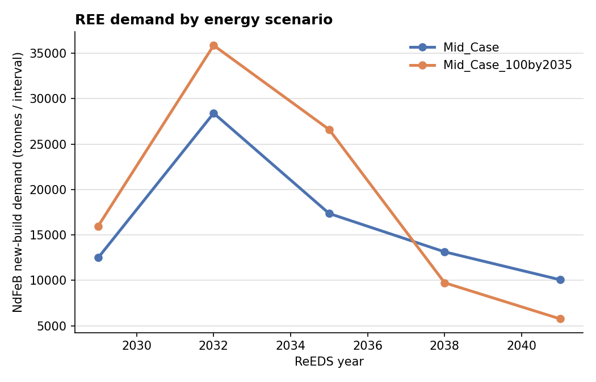
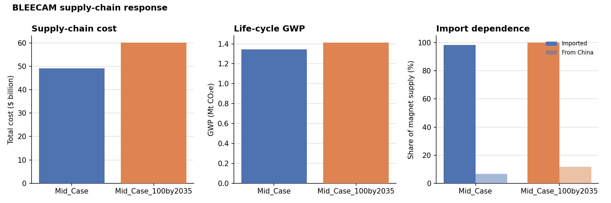
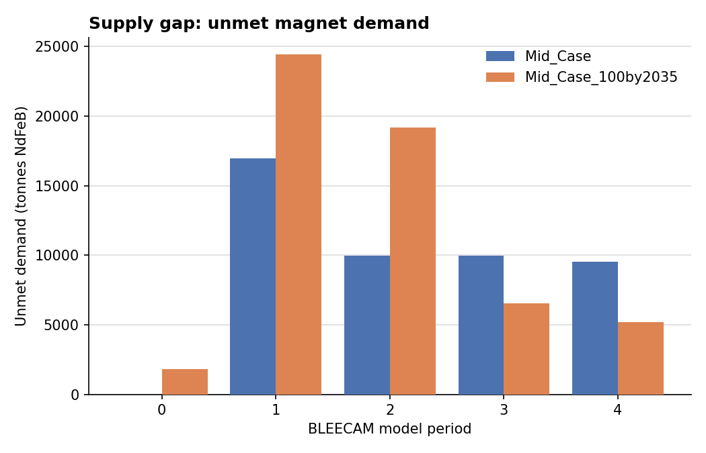

# Energy mix → rare-earth demand → supply-chain strain

### A ReEDS × BLEECAM linkage prototype

*Real NREL 2024 Standard Scenarios · rare-earth (NdFeB) across all power-sector technologies · U.S. national resolution*

---

## 1. Framing

The energy transition is mineral-intensive, and the intensity is wildly uneven across
technologies. This prototype wires a power-sector capacity-expansion model (**ReEDS**) to a
critical-mineral supply-chain optimizer (**BLEECAM**) to answer one question end-to-end:
**when the grid builds out differently, how much more rare-earth does it need, and can the
supply chain deliver it?** We compare a real Standard-Scenarios pair — `Mid_Case` (the central
reference) and `Mid_Case_100by2035` (a 100%-clean-electricity-by-2035 policy case) — and trace
the difference through to cost, life-cycle emissions, import dependence, and unmet demand.

The headline is a **timing** story, not a level story. Essentially all power-sector rare-earth
rides on **wind**, and a clean-by-2035 mandate **pulls wind — and its magnet demand — forward**
rather than raising the cumulative total much: the policy case needs ~15% more NdFeB over
2026–2041, but its demand peaks higher and earlier (2032) and then falls *below* the reference
after ~2037, once its build-out is largely done. That near-term surge is exactly where the
supply chain strains hardest.

## 2. Method

```
ReEDS capacity (MW by tech/year)  ──×  REE-intensity matrix  ──►  NdFeB / Nd / Dy demand
   ──►  BLEECAM Demand_Input_Template.csv  ──►  REE case (ipopt)  ──►  cost / GWP / imports / gap
```

The adapter (`reeds2bleecam.bridge`) is a thin, unit-tested pipeline (36 tests) over two stable
data contracts:

- **ReEDS capacity** — real data from the **NREL 2024 Standard Scenarios**, annual national file
  (`StdScen24_annual_national.csv`, [OEDI submission 6453](https://data.openei.org/submissions/6453)),
  which reports installed capacity by technology every three years (2026–2050). The normalizer
  `from_stdscen_national()` melts the per-tech `*_MW` columns onto the intensity keys
  (`wind_onshore → wind-ons`, `wind_offshore → wind-ofs`, …). We use the first six snapshots
  (2026–2041), where the policy acceleration is sharpest, and map the five build-intervals onto
  the REE case's five model periods. *(A synthetic ReEDS stub, shipped in `data/`, scaffolded and
  unit-tests the capacity→demand math; the pipeline is source-agnostic.)*
- **REE-intensity matrix** (`data/ree_intensity_matrix.csv`) — `ndfeb_kg_per_MW` and NdFeB mass
  fractions per technology: offshore wind ~600 kg/MW (direct-drive PMSG), onshore ~120 kg/MW
  (blended drivetrain), all non-wind = 0. **These are illustrative placeholders** (anchored to
  Carrara et al. 2020 JRC and IEA 2021/2022), not yet publication-grade.

**Capacity → demand** uses a *new-build* basis: magnet demand is the year-over-year Δ of installed
capacity (retirements clipped to zero — they feed the later recycling phase) × intensity, summed
over technologies. **Only BLEECAM's demand input changes** between scenarios; topology, capacity,
cost, emission-factor, and yield tables are untouched. BLEECAM reads magnet demand as
`hp_magnet_demand (kg/MW) × Deployment Curve MW + Data-center magnet kg` per period; we map the
wind build onto that product (capacity-weighted blended intensity) and carry the independent
data-center stream through unchanged.

## 3. Result 1 — REE demand by energy scenario (the wind story)



New-build NdFeB demand over 2026–2041:

| Scenario            | NdFeB (t) | NdPr (t) | Dy (t) |
|---------------------|----------:|---------:|-------:|
| Mid_Case            | 81,479    | 22,814   | 2,444  |
| Mid_Case_100by2035  | 93,965    | 26,310   | 2,819  |

The clean-by-2035 case needs **~15% more NdFeB** cumulatively (and ~15% more dysprosium, the
scarcest, most import-concentrated element), but the figure shows the real mechanism: its demand
**peaks ~26% higher in 2032** (~36 vs ~28 kt/interval) and then crosses *below* the reference
around 2037. Because solar, storage, gas, and nuclear carry no rare-earth at this boundary, the
entire difference is a *wind* story — and the policy's effect is to **compress the wind build into
the early 2030s**, not to enlarge it overall. Compared with the synthetic stub's deliberately
stark ~4× contrast, the real scenarios diverge far more modestly: a useful reality-check on how
much (and when) energy policy actually moves rare-earth demand.

## 4. Result 2 — BLEECAM supply-chain response



| Scenario            | Cost (model $B) | GWP (Mt CO₂e) | Imported share | China share |
|---------------------|----------------:|--------------:|---------------:|------------:|
| Mid_Case            | 49.1            | 1.34          | 98%            | 6.6%        |
| Mid_Case_100by2035  | 60.1            | 1.41          | 100%           | 11.6%       |

Feeding the larger, front-loaded policy demand through BLEECAM raises **modeled supply-chain cost
~22%**, pushes magnet supply to **100% imported**, and **nearly doubles China's share of magnet
manufacturing** (6.6% → 11.6%) as the chain reaches further up the cost curve to meet the near-term
surge. Life-cycle GWP rises only ~5%. *Costs are model objective values for cross-scenario
comparison, not validated procurement prices.*

### Where it breaks: the supply gap



The supply gap mirrors the demand timing. Cumulative unmet magnet demand over the window:

| Scenario            | Supply gap (t NdFeB) |
|---------------------|---------------------:|
| Mid_Case            | 46,412               |
| Mid_Case_100by2035  | 57,127               |

The policy case leaves **~23% more demand unmet overall**, but the gap is **concentrated in the
early periods** (2029–2035, bars 1–2) and then falls *below* the reference later — the supply
chain cannot scale fast enough for the clean-by-2035 surge, even though both scenarios end the
window at similar annual demand. This is the prototype's core result: a faster energy transition
is not necessarily more rare-earth-intensive in total, but it stresses the magnet supply chain
*sooner and harder*, and deepens near-term import and China exposure.

## 5. Caveats and next steps

**Caveats.** Intensity values are illustrative placeholders. The horizon is the REE case's five
model periods, onto which the 2026–2041 ReEDS snapshots are mapped (the full 2026–2050 trajectory
is not yet modeled). Demand is new-build only (no repowering, no 20-year magnet retirements feeding
recycling). The data-center magnet stream is held constant across scenarios. Resolution is
U.S.-national (BLEECAM is country-level). Reported cost is a model objective, not a validated dollar
figure.

**Next steps.**
1. **Publication-grade intensities** — replace the placeholder matrix with sourced Carrara/IEA
   values and a PMSG-share split for onshore wind.
2. **Period extension** — extend BLEECAM's horizon to the full annual 2025–2050 so the late-period
   crossover is modeled directly rather than compressed into five periods.
3. **Stock & recycling** — add repowering and end-of-life magnet flows (BLEECAM's richer second phase).
4. **More scenario pairs** — the loader reads any Standard-Scenarios scenario; contrast e.g.
   `Adv_RE` vs `Con_RE`, or `High_Demand_Growth` vs `Low_Demand_Growth`.
5. **Multi-mineral** — generalize the intensity matrix to PV (Ag/Te) and batteries
   (Li/Co/Ni/graphite); the adapter already maps all technologies, so only the matrix grows.

---

*Reproduce:* `python scripts/run_real.py` runs the real Standard-Scenarios pair end-to-end (needs
`ipopt`) and renders the figures; `python scripts/run_scenarios.py` does the synthetic-stub
version. Bridge math is covered by `tests/` (`python -m pytest tests/`). Real capacity data:
[OEDI submission 6453](https://data.openei.org/submissions/6453).
